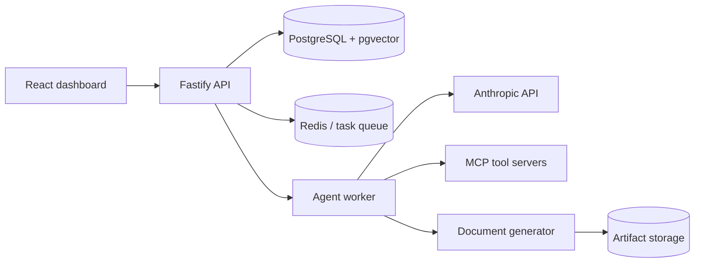

# Woody Agent OS

Backend foundation for the AI Agent Dashboard. It provides authenticated, workspace-scoped APIs for agents, tasks, workflows, tools, memories, knowledge documents, audit events, and dashboard analytics.

For a plain-language guide to using the product, read [WOODY_USER_MANUAL.md](WOODY_USER_MANUAL.md).

## Architecture

The API owns authorization, persistence, audit logging, and task lifecycle. The worker runs queued agents and records tool calls and outputs. The included Python FastAPI ingestion service extracts text from uploaded documents.

## Local setup

1. Copy `.env.example` to `.env` and set `JWT_SECRET`, `ENCRYPTION_KEY`, and `EXTRACTOR_TOKEN`. Generate a key with `node -e "console.log(require('crypto').randomBytes(32).toString('base64'))"`.
2. Run `docker compose up --build` for the dashboard, API, worker, PostgreSQL, Redis, and extractor. The one-off migration service runs before the API and worker start.
3. For local development without containers, run `npm install`, `npm run db:migrate`, `npm run dev`, and `npm run worker` after supplying reachable PostgreSQL/Redis URLs. Docker Compose exposes its Redis service on host port `6380` to avoid clashing with an existing local Redis installation.
4. Open `http://localhost:3002` for Woody or `http://localhost:3001/docs` for the API reference.
5. For UI-only development, run `cd web-stitch && npm install && npm run dev`; set `VITE_API_URL=http://localhost:3001` in `web-stitch/.env.local` when needed.

On macOS, double-click `Install Woody.command` once, then use `Woody.app` from Applications for one-click startup. Woody hands startup to Terminal so macOS can use Terminal's Documents permission to read the local `.env`; the Terminal window shows Docker progress and opens `http://localhost:3002/dashboard` when healthy.

## External services

- Choose a model provider with `LLM_PROVIDER`. For Anthropic, set `LLM_PROVIDER=anthropic` and `ANTHROPIC_API_KEY`. For an OpenAI-compatible provider, set `LLM_PROVIDER=openai-compatible`, `LLM_API_KEY`, `LLM_BASE_URL` (the API root, such as `https://provider.example/v1`), and `LLM_DEFAULT_MODEL`. The production worker refuses to start without the selected provider's credentials.
- `EMBEDDING_API_URL` and optional `EMBEDDING_API_KEY` enable 1536-dimensional pgvector semantic search. Without them, knowledge search falls back to PostgreSQL full-text search.
- `OIDC_ISSUER`, `OIDC_CLIENT_ID`, and `OIDC_CLIENT_SECRET` enable generic OpenID Connect login at `/v1/auth/oidc/login`.
- Tool credentials live in `tools.config` encrypted with `ENCRYPTION_KEY`; never rotate this key without migrating stored tool configurations.
- MCP credentials use a versioned AES-256-GCM envelope bound to the workspace and connection. `ENCRYPTION_KEY_ID` identifies the active key; `ENCRYPTION_KEYS` can hold an explicit keyring during rotation.

## MCP Marketplace

Open `http://localhost:3002/mcp` to browse the cached official MCP Registry or add a custom remote Streamable HTTP endpoint.

Safe installation order:

1. Install a Registry entry or custom HTTPS endpoint. It starts disabled.
2. Select no authentication, OAuth 2.1/PKCE, a bearer token, or write-only custom headers.
3. Test the MCP initialization/session and run tool discovery.
4. Review each discovered tool's risk classification and enable only required tools.
5. Enable the healthy connection.
6. Assign the connection to an agent, choose `read` or `read_write`, and save an explicit per-agent tool allowlist.
7. Review calls in the Marketplace Activity tab. Unknown, destructive, and external-write actions pause the task for owner/admin confirmation.

The runtime supports Streamable HTTP through `@modelcontextprotocol/sdk`. Transport code is behind an adapter interface so stdio can be added later without reusing or changing the existing REST tool execution path.

Security controls include HTTPS-only endpoints, private/reserved network blocking at validation and socket resolution, redirect blocking, encrypted credentials and model checkpoints, secret-redacted logs, workspace-scoped authorization, disabled-by-default discovery, exact one-time confirmations, and health backoff. Registry metadata and MCP tool descriptions are treated as untrusted input.

Registry and OAuth settings:

- `MCP_REGISTRY_URL` defaults to the official Registry.
- `MCP_REGISTRY_SYNC_INTERVAL_HOURS` controls incremental catalog refreshes.
- `MCP_OAUTH_CALLBACK_URL` must be an allowed OAuth redirect and normally uses the port `3002` proxy.
- `MCP_APP_URL` is where OAuth returns the user after authorization.

## Downloadable artifacts

Tasks and workflow output nodes can request PDF, DOCX, PPTX, and XLSX files. The
agent result remains the canonical Markdown/JSON output; a separate background
job renders deterministic office files through the document service. Artifact
metadata, checksums, workspace ownership, and lifecycle state are stored in
PostgreSQL while binary files live behind a storage adapter. Docker Compose uses
the durable `artifact_data` volume mounted at `/data/artifacts` in both the API
and worker. Set `ARTIFACT_STORAGE_DIR` for non-Docker deployments.

Downloads require the same workspace Bearer authentication as task data. PDF
can open inline; office files download for their native applications.
Generation errors are isolated from the canonical agent or workflow result and
can be retried from the execution UI. The API never accepts model-invented
base64 files: the model supplies canonical Markdown and trusted code performs
the format conversion.

## Workflow control flow

Workflow runs snapshot their definition and persist a cursor plus every node
attempt. Conditions use safe state paths and explicit true/false edges. Agent
and action nodes can retry up to five times with bounded exponential backoff.
Loops are explicit `forEach` or `while` nodes, require body/done/continue edges,
and stop at a configured maximum of 100 iterations. Arbitrary graph cycles are
still rejected. The execution trace records branch decisions, attempts, loop
iteration keys, approvals, errors, and generated artifacts.

Write-capable tools are additionally protected at save time and execution time:
they must be directly preceded by a completed human-approval node for the same
loop iteration and cannot use automatic retries. This prevents an older saved
definition from bypassing the current workflow validator.

## Core routes

`/v1/auth` (including persistent versioned onboarding), `/v1/runtime/config` (safe provider/model metadata only), `/v1/agents`, `/v1/teams`, `/v1/tasks`, `/v1/artifacts`, `/v1/workflows`, `/v1/tools`, `/v1/mcp`, `/v1/memories`, `/v1/knowledge`, `/v1/prompts`, `/v1/analytics`, and `/v1/audit-events`.

Every business route is workspace-scoped and requires a Bearer access token.
